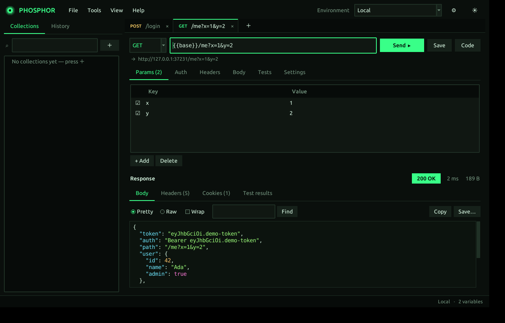
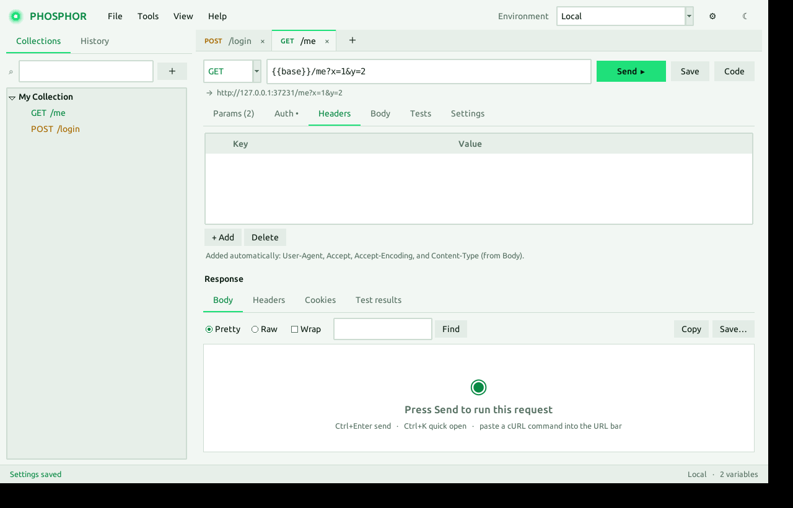

**[English](README.md)** · فارسی

# ◉ Phosphor

**کلاینت API سبک و گرافیکی برای اوبونتو، با ظاهر مدرن و تم سبز فسفری.**
یک فایل پایتون، بدون Electron، بدون نیاز به `pip` و بدون حساب کاربری.

Phosphor برای کسی ساخته شده که می‌خواهد API بزند، پاسخ را ببیند، توکن لاگین را ذخیره کند و درخواست‌ها را مرتب نگه دارد، بدون اینکه برنامه چند صد مگابایت رم بگیرد.





---

## نصب

```bash
git clone https://github.com/alishe79/phosphor.git
cd phosphor
bash install.sh
```

این دستور در صورت نیاز `python3-tk` را نصب می‌کند (تنها بخشی که `sudo` می‌خواهد)، برنامه را به منوی اوبونتو اضافه می‌کند و دستور `phosphor` را می‌سازد.

اگر نصب نمی‌خواهی:

```bash
sudo apt install python3-tk
python3 phosphor.py
```

**نیازمندی‌ها:** اوبونتو (یا هر لینوکس دیگر) با Python 3 و `python3-tk` (تست‌شده با Python 3.12 روی اوبونتو ۲۴٫۰۴). هیچ بسته‌ی دیگری لازم نیست.

> اگر قبلاً MiniPost را داشتی، کالکشن‌ها و محیط‌هایت بار اول خودکار به Phosphor منتقل می‌شوند.

---

## شروع سریع

1. آدرس را در نوار بالا بنویس، متد را انتخاب کن و `Ctrl+Enter` بزن.
2. پاسخ پایین نمایش داده می‌شود: JSON رنگی و مرتب، کد وضعیت، زمان و حجم.
3. برای ذخیره‌ی درخواست `Ctrl+S` بزن و یک کالکشن انتخاب کن.
4. یک دستور cURL را مستقیم در نوار آدرس paste کن؛ خودش به درخواست کامل تبدیل می‌شود.

### نمونه: لاگین و ذخیره‌ی خودکار توکن

1. بالا سمت راست یک Environment بساز (آیکن ⚙) و انتخابش کن.
2. درخواست لاگین را بفرست. در تب **Tests** بنویس:
   ```
   status == 200
   set authToken = json.token
   ```
3. بعد از هر Send، توکن در Environment فعال ذخیره می‌شود.
4. در درخواست‌های دیگر، تب **Auth** ← Bearer ← Token: `{{authToken}}`

---

## قابلیت‌ها

| بخش | توضیح |
|---|---|
| **درخواست‌ها** | GET، POST، PUT، PATCH، DELETE، HEAD، OPTIONS؛ چند تب همزمان؛ ذخیره و بازیابی تب‌ها بعد از بستن برنامه |
| **Params / Headers** | جدول قابل ویرایش با تیک فعال/غیرفعال؛ Params با URL همگام است |
| **Auth** | Bearer، Basic، API Key (در هدر یا Query) |
| **Body** | raw (JSON، XML، HTML، Text، JavaScript)، form-data با آپلود فایل، x-www-form-urlencoded، binary |
| **کالکشن‌ها** | پوشه و زیرپوشه، تغییر نام، کپی، جابه‌جایی، جستجو، اجرای همه‌ی درخواست‌های یک پوشه (Runner) |
| **محیط و متغیر** | Environments و Globals با `{{name}}`؛ متغیرهای داخلی `{{$timestamp}}`، `{{$guid}}`، `{{$randomInt}}`، `{{$isoTimestamp}}` |
| **Tests** | قواعد ساده‌ی یک‌خطی (پایین را ببین) و ذخیره‌ی مقدار پاسخ در متغیر |
| **پاسخ** | JSON رنگی، حالت Pretty/Raw، جستجو، Copy، ذخیره در فایل، هدرها، کوکی‌ها، نتایج تست |
| **تولید کد** | cURL، Python (requests)، JavaScript (fetch) |
| **ایمپورت / اکسپورت** | کالکشن Postman (v2.x)، Environment پست‌من، دستور cURL؛ اکسپورت کالکشن به فرمت Postman |
| **جستجوی سریع** | `Ctrl+K` بین درخواست‌های ذخیره‌شده و تاریخچه |
| **راهنمای متغیر** | زیر نوار آدرس، URL باز‌شده نشان داده می‌شود و متغیر تعریف‌نشده هشدار می‌گیرد |
| **تنظیمات** | پراکسی HTTP، تایم‌اوت، تایید SSL، دنبال کردن ریدایرکت، کوکی‌ها (در حافظه‌ی جلسه) |
| **ظاهر** | تم تیره و روشن، زوم، آیکن، tooltip |

### زبان Tests

در تب **Tests** هر خط یک قاعده است:

```
status == 200
time < 800
size < 50000
header Content-Type contains json
json.data.id exists
json.items[0].name == "x"
body contains success
body not contains error
set authToken = json.token
```

- **مقدارها:** `status`، `time` (میلی‌ثانیه)، `size`، `body`، `header NAME`، `json.مسیر`
- **عملگرها:** `==  !=  <  >  <=  >=  contains  not contains  exists`
- **ذخیره در متغیر:** `set نام = مقدار`؛ اگر Environment فعال باشد در آن، وگرنه در Globals ذخیره می‌شود
- خط‌هایی که با `#` شروع شوند نادیده گرفته می‌شوند

نتیجه‌ی هر قاعده با ✓ یا ✗ در تب **Test results** پاسخ نشان داده می‌شود.

### میانبرها

| میانبر | کار |
|---|---|
| `Ctrl+Enter` | ارسال |
| `Ctrl+S` | ذخیره در کالکشن |
| `Ctrl+K` | جستجوی سریع |
| `Ctrl+T` / `Ctrl+W` | تب جدید / بستن تب |
| `Ctrl+Tab` | تب بعدی |
| `Ctrl+L` | رفتن به نوار آدرس |
| `Ctrl+Shift+E` | مدیریت Environmentها |
| `Ctrl +` / `Ctrl -` | زوم |

کلیک وسط روی تب آن را می‌بندد و کلیک راست گزینه‌های بیشتر می‌دهد.

---

## مقایسه با Postman

> این جدول بر اساس دانسته‌های عمومی درباره‌ی Postman است و Postman مرتب تغییر می‌کند؛ قبل از تصمیم نهایی، نسخه‌ی فعلی آن را هم نگاه کن.
> هدف Phosphor جایگزین کامل Postman نیست. هدفش این است که برای کار روزمره‌ی API سریع‌تر، سبک‌تر و ساده‌تر باشد.

### سبکی و نصب

| ویژگی | Phosphor | Postman |
|---|---|---|
| ساختار | یک فایل پایتون (حدود ۱۳۰ کیلوبایت) | برنامه‌ی Electron (چند صد مگابایت نصب) |
| مصرف رم در حالت بیکار | حدود ۴۰ مگابایت (اندازه‌گیری‌شده) | معمولاً چند صد مگابایت |
| مصرف CPU در حالت بیکار | عملاً صفر (برنامه فقط هنگام ارسال درخواست کار می‌کند) | وابسته به نسخه و همگام‌سازی؛ معمولاً بیشتر |
| نیاز به حساب کاربری | ندارد | برای بخش زیادی از قابلیت‌ها معمولاً دارد |
| نیاز به اینترنت برای اجرا | ندارد | بخش‌های ابری به آن وابسته‌اند |
| وابستگی‌ها | فقط `python3-tk` | همراه بسته‌ی خودش |
| حریم خصوصی داده | همه‌چیز در یک فایل محلی (`~/.config/phosphor/data.json`) | کالکشن‌ها معمولاً در فضای ابری |
| سورس | یک فایل قابل خواندن و تغییر | بسته |

### قابلیت‌ها

| قابلیت | Phosphor | Postman |
|---|---|---|
| درخواست HTTP با همه‌ی متدها | ✅ | ✅ |
| کالکشن، پوشه و زیرپوشه | ✅ | ✅ |
| Environment و Globals و متغیر `{{}}` | ✅ | ✅ |
| Params، Headers، Auth، Body | ✅ | ✅ |
| form-data و آپلود فایل | ✅ | ✅ |
| تولید کد (cURL، Python، JS) | ✅ (۳ زبان) | ✅ (زبان‌های بیشتر) |
| ایمپورت cURL با paste در نوار آدرس | ✅ | ✅ |
| ایمپورت/اکسپورت کالکشن Postman | ✅ | ✅ |
| تست و ذخیره‌ی توکن در متغیر | ✅ (قواعد ساده‌ی یک‌خطی) | ✅ (اسکریپت JavaScript کامل) |
| Runner برای اجرای یک پوشه | ✅ (ساده) | ✅ (پیشرفته، با داده‌ی ورودی و گزارش) |
| جستجوی سریع `Ctrl+K` | ✅ | ✅ |
| تم تیره و روشن | ✅ | ✅ |
| هشدار متغیر تعریف‌نشده زیر نوار آدرس | ✅ | ✅ (با رنگ‌بندی متغیر) |
| پراکسی | ✅ | ✅ |

### چیزهایی که Postman دارد و Phosphor ندارد

| قابلیت | Phosphor | Postman |
|---|---|---|
| اسکریپت پیش از درخواست (pre-request) و اسکریپت JavaScript | ❌ | ✅ |
| همکاری تیمی و همگام‌سازی ابری | ❌ | ✅ |
| Mock Server و Monitor | ❌ | ✅ |
| WebSocket، gRPC، GraphQL اختصاصی | ❌ | ✅ |
| تولید مستندات API | ❌ | ✅ |
| احراز هویت OAuth 2.0 و AWS Signature | ❌ | ✅ |
| نسخه‌ی ویندوز و مک | ⚠️ ممکن است با Python و Tk اجرا شود، ولی روی اوبونتو تست شده | ✅ |

### جمع‌بندی

**Phosphor را انتخاب کن اگر:** به سرعت، سبکی، حریم خصوصی و ظاهر تمیز اهمیت می‌دهی، کارت بیشتر زدن API، دیدن پاسخ و ذخیره‌ی توکن است، و نمی‌خواهی حساب کاربری بسازی یا چیز سنگینی نصب کنی.

**Postman را نگه دار اگر:** تیمی کار می‌کنی، به اسکریپت‌نویسی پیشرفته، Mock Server، OAuth یا WebSocket و gRPC نیاز داری.

می‌توانی هر دو را کنار هم داشته باشی: کالکشن را از Postman اکسپورت کن و در Phosphor ایمپورت کن (File ← Import).

---

## محل ذخیره‌ی داده‌ها

همه‌چیز در یک فایل JSON ذخیره می‌شود:

```
~/.config/phosphor/data.json
```

شامل کالکشن‌ها، Environmentها، تاریخچه (۱۰۰ درخواست آخر)، تنظیمات و تب‌های باز. برای پشتیبان‌گیری همین فایل را کپی کن. برای شروع از صفر، آن را حذف کن.

> توکن‌ها و رمزها داخل این فایل به‌صورت متن ساده ذخیره می‌شوند. آن را جایی عمومی نگذار و در گیت کامیت نکن.

---

## محدودیت‌ها

- فقط HTTP/HTTPS (بدون WebSocket و gRPC).
- اسکریپت JavaScript ندارد؛ به‌جایش زبان ساده‌ی Tests هست.
- پاسخ‌ها تا ۲۵ مگابایت دریافت می‌شوند و برای روان ماندن رابط، حداکثر حدود ۱٫۵ میلیون کاراکتر نمایش داده می‌شود (برای کل بدنه از دکمه‌ی **Save…** استفاده کن).
- کوکی‌ها فقط در حافظه‌ی جلسه نگه داشته می‌شوند و بعد از بستن برنامه پاک می‌شوند (از منوی Tools ← Cookies قابل مشاهده‌اند).

## عیب‌یابی

| مشکل | راه حل |
|---|---|
| `ModuleNotFoundError: No module named 'tkinter'` | `sudo apt install python3-tk` |
| `Can't open a display` | برنامه را داخل محیط گرافیکی اجرا کن (نه SSH بدون X) |
| دستور `phosphor` پیدا نمی‌شود | یک بار خارج و دوباره وارد سشن شو، یا `~/.local/bin` را به `PATH` اضافه کن |
| خطای گواهی SSL | در تب **Settings** درخواست، گزینه‌ی Verify SSL را خاموش کن (فقط برای سرور خودت) |
| متن‌ها کوچک یا بزرگ‌اند | `Ctrl +` و `Ctrl -` |

## حذف

```bash
rm -rf ~/.local/share/phosphor ~/.local/bin/phosphor ~/.local/share/applications/phosphor.desktop
rm -rf ~/.config/phosphor   # حذف داده‌ها (اختیاری)
```

## مجوز

MIT، آزادانه استفاده، تغییر و منتشر کن. جزئیات در فایل [LICENSE](LICENSE).

## مشارکت

Issue و Pull Request پذیرفته است. قوانین کامل مشارکت، از جمله سیاست استفاده از ابزارهای هوش مصنوعی، در [README انگلیسی](README.md#contributing) آمده است. خلاصه: برنامه عمداً در یک فایل و بدون وابستگی خارجی نگه داشته شده؛ لطفاً این قید را حفظ کنید و قبل از ارسال، تست‌ها را اجرا کنید.
