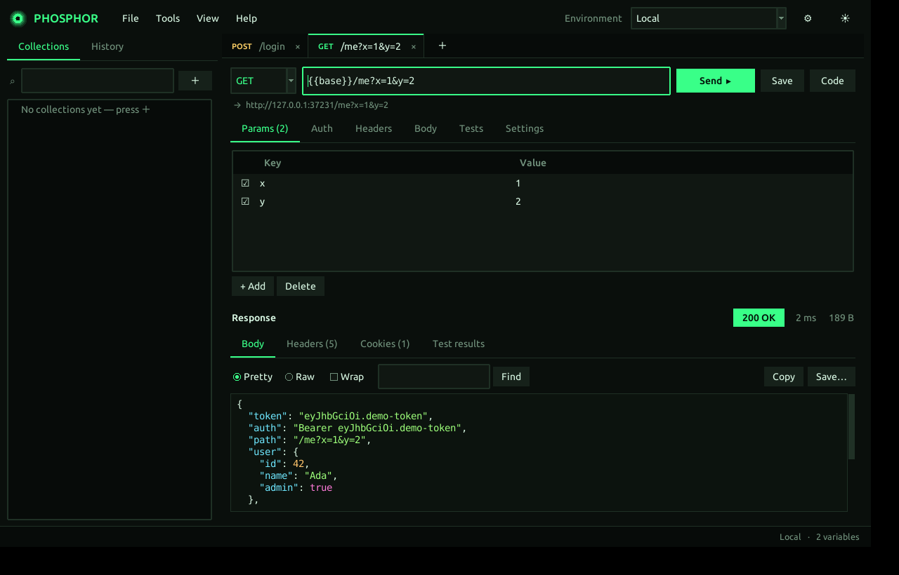
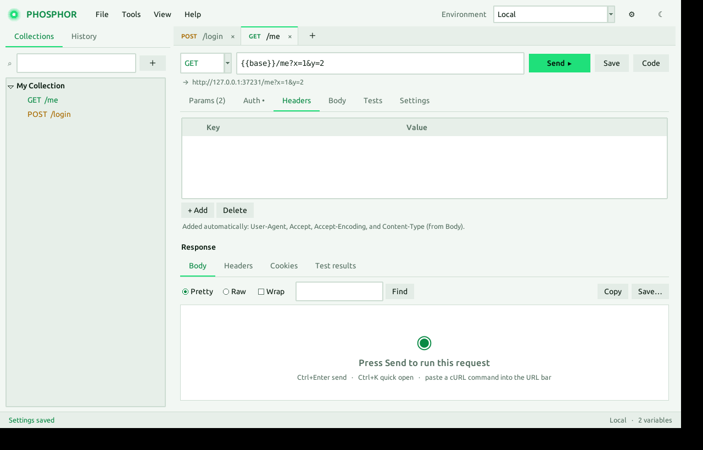

# ◉ Phosphor

**English** · [فارسی](README.fa.md)

**A tiny, fast API client for Linux with a phosphor-green UI.**
One Python file. No Electron, no `pip install`, no account, no telemetry.



Phosphor is for people who want to send HTTP requests, inspect responses, keep requests organised and chain them with variables, without a multi-hundred-megabyte app running in the background. It is a lightweight alternative to Postman for everyday API work, not a full replacement.

<details>
<summary>Light theme</summary>



</details>

## Contents

- [Why Phosphor](#why-phosphor)
- [Install](#install)
- [Quick start](#quick-start)
- [Features](#features)
- [Tests language](#tests-language)
- [Keyboard shortcuts](#keyboard-shortcuts)
- [Comparison with Postman](#comparison-with-postman)
- [Where your data lives](#where-your-data-lives)
- [Limitations](#limitations)
- [Troubleshooting](#troubleshooting)
- [Contributing](#contributing)
- [AI-assisted development policy](#ai-assisted-development-policy)
- [How this project was built](#how-this-project-was-built)
- [Security](#security)
- [License](#license)

## Why Phosphor

- **Light.** One ~130 KB file. About 40 MB of RAM and near-zero CPU when idle (measured on Ubuntu 24.04 with Python 3.12).
- **Private.** No account, no cloud sync, no analytics. Everything is stored in one local JSON file.
- **Complete enough.** Collections, environments, variables, auth, all body types, tests, cURL import, code generation, Postman import/export.
- **Pleasant.** Dark and light themes, coloured method badges, quick open, a live preview of your URL with variables resolved.
- **Hackable.** Standard library only. You can read the whole program in an afternoon.

## Install

```bash
git clone https://github.com/alishe79/phosphor.git
cd phosphor
bash install.sh
```

The installer adds Phosphor to your application menu and creates a `phosphor` command. It only asks for `sudo` to install `python3-tk` if that is missing.

Prefer not to install anything?

```bash
sudo apt install python3-tk
python3 phosphor.py
```

**Requirements:** Linux with Python 3 and Tk (`python3-tk`). Tested on Ubuntu 24.04 with Python 3.12. Other distributions should work if Tk is available; reports are welcome.

If you used the earlier MiniPost build, your collections and environments are migrated automatically on first launch.

**Uninstall**

```bash
rm -rf ~/.local/share/phosphor ~/.local/bin/phosphor ~/.local/share/applications/phosphor.desktop
rm -rf ~/.config/phosphor   # optional: also delete your saved data
```

## Quick start

1. Type a URL, pick a method, press `Ctrl+Enter`.
2. Read the response: coloured JSON, status, time and size.
3. Press `Ctrl+S` to save the request into a collection.
4. Paste a `curl ...` command straight into the URL bar to import it.

### Example: log in once, reuse the token everywhere

1. Create an environment (⚙ button, top right) and select it.
2. In your login request, open the **Tests** tab and write:
   ```
   status == 200
   set authToken = json.token
   ```
3. Send the request. The token is stored in the active environment.
4. In any other request, open **Auth**, choose **Bearer**, and use `{{authToken}}` as the token.

## Features

| Area | What you get |
|---|---|
| Requests | GET, POST, PUT, PATCH, DELETE, HEAD, OPTIONS. Multiple tabs, restored on next launch. |
| Params and headers | Editable tables with per-row on/off checkboxes. Params stay in sync with the URL. |
| Auth | Bearer, Basic, API Key (header or query). |
| Body | raw (JSON, XML, HTML, Text, JavaScript), form-data with file upload, x-www-form-urlencoded, binary. |
| Collections | Folders and sub-folders, rename, duplicate, move, filter, and a Runner that executes a whole folder. |
| Environments | Environments and Globals with `{{name}}`. Built-ins: `{{$timestamp}}`, `{{$guid}}`, `{{$randomInt}}`, `{{$isoTimestamp}}`. |
| Tests | One-line rules, and saving response values into variables. |
| Response | Coloured JSON, Pretty/Raw, search, copy, save to file, headers, cookies, test results. |
| Code generation | cURL, Python (requests), JavaScript (fetch). |
| Import / export | Postman collections (v2.x), Postman environments, cURL commands. Export collections in Postman format. |
| Quick open | `Ctrl+K` searches saved requests and history. |
| URL preview | Shows the URL with variables resolved and warns about undefined ones. |
| Settings | HTTP proxy, timeout, SSL verification, redirects, theme, zoom. |

## Tests language

Each line of the **Tests** tab is one rule:

```
status == 200
time < 800
size < 50000
header Content-Type contains json
json.data.id exists
json.items[0].name == "x"
body contains success
body not contains error
set authToken = json.token
```

- **Values:** `status`, `time` (ms), `size`, `body`, `header NAME`, `json.path`
- **Operators:** `==  !=  <  >  <=  >=  contains  not contains  exists`
- **Saving values:** `set name = value` writes to the active environment, or to Globals if none is selected
- Lines starting with `#` are ignored

Results appear with ✓ or ✗ in the **Test results** tab of the response.

## Keyboard shortcuts

| Shortcut | Action |
|---|---|
| `Ctrl+Enter` | Send |
| `Ctrl+S` | Save to a collection |
| `Ctrl+K` | Quick open |
| `Ctrl+T` / `Ctrl+W` | New / close tab |
| `Ctrl+Tab` | Next tab |
| `Ctrl+L` | Focus the URL bar |
| `Ctrl+Shift+E` | Manage environments |
| `Ctrl +` / `Ctrl -` | Zoom |

Middle-click a tab to close it; right-click for more options.

## Comparison with Postman

> This table reflects general knowledge of Postman, which changes often. Check its current version before deciding.
> Phosphor does not aim to replace Postman. It aims to be faster, lighter and simpler for day-to-day API work.

### Weight and setup

| | Phosphor | Postman |
|---|---|---|
| Form | One Python file (~130 KB) | Electron app (hundreds of MB installed) |
| Idle RAM | ~40 MB (measured) | Typically several hundred MB |
| Idle CPU | Near zero (only works while a request runs) | Varies by version and sync activity |
| Account required | No | Usually, for much of the feature set |
| Works offline | Yes | Cloud features need a connection |
| Dependencies | `python3-tk` | Bundled |
| Your data | One local JSON file | Collections typically live in the cloud |
| Source | One readable file | Closed |

### Features both have

| Feature | Phosphor | Postman |
|---|---|---|
| All HTTP methods | ✅ | ✅ |
| Collections, folders, sub-folders | ✅ | ✅ |
| Environments, globals, `{{variables}}` | ✅ | ✅ |
| Params, headers, auth, all body types | ✅ | ✅ |
| form-data with file upload | ✅ | ✅ |
| Code generation | ✅ (3 languages) | ✅ (more languages) |
| cURL import by pasting | ✅ | ✅ |
| Postman collection import / export | ✅ | ✅ |
| Tests and saving tokens into variables | ✅ (simple one-line rules) | ✅ (full JavaScript) |
| Folder Runner | ✅ (basic) | ✅ (advanced: data files, reports) |
| Quick open | ✅ | ✅ |
| Dark and light themes | ✅ | ✅ |
| Proxy | ✅ | ✅ |

### What Postman has that Phosphor does not

| Feature | Phosphor | Postman |
|---|---|---|
| Pre-request and full JavaScript scripting | ❌ | ✅ |
| Team collaboration and cloud sync | ❌ | ✅ |
| Mock servers and monitors | ❌ | ✅ |
| WebSocket, gRPC, dedicated GraphQL | ❌ | ✅ |
| API documentation generation | ❌ | ✅ |
| OAuth 2.0 and AWS Signature auth | ❌ | ✅ |
| Windows and macOS builds | ⚠️ Tested on Ubuntu only | ✅ |

**Choose Phosphor** if you value speed, a small footprint, privacy and a clean UI, and your work is mostly sending requests, reading responses and chaining tokens.
**Keep Postman** if you work in a team or need advanced scripting, mock servers, OAuth, WebSocket or gRPC.
You can use both: export from Postman and import into Phosphor via **File → Import**.

## Where your data lives

```
~/.config/phosphor/data.json
```

Collections, environments, the last 100 history entries, settings and open tabs. Copy this file to back up; delete it to start fresh.

> Tokens and passwords are stored there as plain text. Do not share the file or commit it to a repository.

## Limitations

- HTTP and HTTPS only (no WebSocket or gRPC).
- No JavaScript scripting; the Tests language is intentionally small.
- Responses larger than 25 MB are truncated, and the viewer shows at most ~1.5 million characters. Use **Save…** to write the full body to disk.
- Cookies live in memory for the session and are cleared when the app closes (Tools → Cookies shows them).
- Developed and tested on Ubuntu only.

## Troubleshooting

| Problem | Fix |
|---|---|
| `No module named 'tkinter'` | `sudo apt install python3-tk` |
| `Can't open a display` | Run inside a graphical session (not plain SSH without X forwarding) |
| `phosphor: command not found` | Log out and in again, or add `~/.local/bin` to your `PATH` |
| SSL certificate error | In the request's **Settings** tab, turn off *Verify SSL certificate* (only for servers you control) |
| Text too small or large | `Ctrl +` / `Ctrl -` |

## Contributing

Contributions are welcome: bug reports, ideas, documentation, translations and code. This section is the full guide.

### Ways to help

- **Report a bug.** Open an issue with: what you did, what you expected, what happened, your distro and Python version (`python3 --version`), and a screenshot or the terminal output if there is one. A request that reproduces the bug, with secrets removed, is ideal.
- **Suggest a feature.** Open an issue first and describe the problem you want solved, not only the solution. Small, focused features that fit the project goals are most likely to be accepted.
- **Improve the docs.** Typos, clearer wording and translations are very welcome.
- **Test on other distributions.** Tell us what worked and what did not (Fedora, Arch, Debian, other Python versions).
- **Send code.** See below.

### Project principles

Pull requests are judged against these goals. Please keep them in mind before you start.

1. **One file, standard library only.** `phosphor.py` must stay a single file with no third-party packages.
2. **Light.** No background polling. The app should use near-zero CPU while idle. Do blocking work in a thread and report back through the existing queue (`run_bg` / `post`).
3. **Private.** No telemetry, no automatic network calls, no external services. The app only talks to the servers the user asks it to.
4. **Careful with user data.** Never lose saved data. Write files atomically, and keep old data loadable (add defaults instead of breaking the format).
5. **Consistent UI.** Reuse the existing styles and palette. Every visual change must look right in both the dark and the light theme.
6. **Honest and simple.** Prefer a small, readable solution over a clever one. Avoid new settings when a good default will do.

### Development setup

```bash
git clone https://github.com/alishe79/phosphor.git
cd phosphor
sudo apt install python3-tk xvfb      # xvfb is only needed for the GUI test
python3 phosphor.py
```

Run the checks before you open a pull request:

```bash
python3 -m pip install --user pyflakes        # or: sudo apt install python3-pyflakes
python3 -m pyflakes phosphor.py               # must print nothing
python3 tests/test_logic.py                   # request building, tests language, import/export
xvfb-run -a python3 tests/test_gui.py         # drives the real interface on a virtual display
```

`test_gui.py` exercises tabs, environments, saving, quick open, the runner, themes and session restore. Set `PHOSPHOR_SHOTS=/some/dir` to also save screenshots (needs ImageMagick's `import`).

### Code layout

`phosphor.py` is organised in sections, top to bottom:

| Section | Contents |
|---|---|
| data / storage | Loading and saving `data.json` |
| variables | `{{name}}` substitution |
| request building / sending | `prepare()` and `execute()` (no UI code) |
| tests | The one-line tests language |
| import / export / code generation | cURL and Postman conversion, code snippets |
| widgets | `Tip`, `SegTabs`, `DocTabs`, `KVTable` |
| request tab | `RequestPane`, one per open tab |
| application | `App`: theme, sidebar, collections, dialogs, session |

Keep logic that does not need Tk (parsing, building requests, tests) in the top sections so it stays testable without a display.

### Code style

- Follow the style of the surrounding code. Four-space indentation, f-strings, short functions.
- Keep lines readable. Existing code goes up to about 180 characters, but shorter is better.
- Name things clearly; comment the *why*, not the *what*.
- `pyflakes` must be clean.
- Do not reformat code you are not changing; it makes reviews hard.
- New user-visible features need a line in this README (Features table or Tests language).

### Pull request rules

1. **One thing per pull request.** A bug fix, a feature or a refactor, not all three.
2. **Open an issue first** for anything larger than a small fix, so effort is not wasted.
3. **Run the checks** listed above and say so in the PR description.
4. **Add or update tests** for logic you change. For UI changes, say how you verified them.
5. **UI changes need screenshots** in both the dark and the light theme.
6. **Do not break saved data.** If you change the data format, old `data.json` files must still load.
7. **No new dependencies** and no splitting the program into several files without prior discussion.
8. **Write a clear title and description.** Explain what changed and why. Link the issue it closes.
9. **Be ready for review.** Maintainers may ask for changes or for you to explain a decision. A PR can be closed if it goes quiet for a long time.
10. **Disclose AI assistance** as described in the next section.

### Commit messages

Short imperative subject line (about 50–70 characters), then a blank line and an optional explanation of the *why*.

```
Fix crash when closing a tab during a request

The worker thread tried to update widgets of a destroyed tab. Clear the
pane's token on close so late results are ignored.
```

### Code of conduct

Be kind and assume good intent. Critique code, not people. Harassment, personal attacks and discrimination are not tolerated, and the maintainers may remove comments or block users who engage in them. Everyone is welcome here, whatever their experience level or language; questions from beginners are fine.

## AI-assisted development policy

**Using AI tools, including "vibe coding", to contribute to Phosphor is allowed.** We care about the quality and safety of what is merged, not about which tool produced it. This project itself was built with AI assistance (see [below](#how-this-project-was-built)), so a blanket ban would be hypocritical. What we ask for is close human supervision.

If you use an AI assistant, you agree that:

1. **You are the author and you are responsible.** The assistant is a tool. You must read and understand every line you submit, and be able to explain it in review.
2. **You tested it.** Run the checks above and, for UI work, actually run the app and look at the result. "The model said it works" is not testing.
3. **You verified the facts.** AI tools invent APIs, options and behaviour. Check against the Python/Tk documentation and by running the code. Do not add claims to the docs that you have not verified.
4. **You disclose it.** Tick the AI-assistance box in the pull request template and mention the tool in the description. A short note is enough, and it never counts against you.
5. **Keep changes small and reviewable.** Do not submit large, auto-generated rewrites or mass reformatting. Review bots and humans both struggle with them, and they will be closed.
6. **Respect the project principles** (single file, no dependencies, no telemetry), even if the assistant suggests otherwise.
7. **Mind secrets and licences.** Do not paste tokens, private data or data from your `data.json` into AI tools or into issues. Do not submit code you know or suspect was copied from a project with an incompatible licence.
8. **Stay in the loop.** If a maintainer asks a question about your change, answer it yourself. Pasting a model's reply that you have not understood or checked is not acceptable.

Maintainers may apply the same policy to their own work. Pull requests that look unreviewed (for example: code that does not run, invented features, ignored feedback) may be closed without a detailed review.

## How this project was built

Phosphor was created in conversation with an AI assistant (Claude by Anthropic) under the maintainer's direction and review. The assistant wrote most of the first implementation; the interface was run on a virtual display, exercised with the automated tests in `tests/`, and visually inspected. The maintainer decides the direction, reviews changes and is responsible for what ships.

We mention this openly because we think transparency is better than guessing, and because it shows what careful AI-assisted work can look like: small steps, real tests, human judgement.

## Security

If you find a security problem (for example, a way a crafted collection file or server response could run code or leak data), please **do not open a public issue**. Use GitHub's *Report a vulnerability* button under the repository's **Security** tab, or contact the maintainer privately. Include steps to reproduce.

Reminder: Phosphor stores tokens and passwords in `~/.config/phosphor/data.json` as plain text. Protect that file like any other credential store.

## License

MIT. Use, modify and share freely. See [LICENSE](LICENSE).
